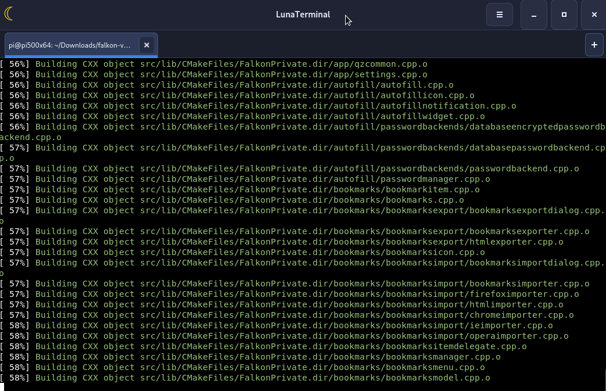

# LunaTerminal 0.5.0

**LunaTerminal** ist ein GTK-4-/VTE-basierter Terminalemulator für Linux. Die Anwendung bietet mehrere Terminal-Tabs, konfigurierbare Profile und eine native Shell in einer übersichtlichen Desktop-Oberfläche.

Getestete Zielplattform: **Debian 13 (Trixie) / Raspberry Pi OS**, insbesondere Raspberry Pi mit GTK 4 und VTE 3.91. Andere GTK-4-Linux-Desktops können ebenfalls funktionieren.



[Github Seite](https://github.com/Angonikro/LunaTerminal/)

## Funktionen

- Mehrere Terminal-Tabs und mehrere Fenster
- Echte Benutzer-Shell (z. B. Bash oder Zsh)
- Profile mit eigenen Farben, Schriftart, Deckkraft, Cursor- und Scroll-Einstellungen
- Profile anlegen, auswählen und löschen
- Profilwechsel ohne Programmneustart
- Hörbare Terminal-Glocke mit mitgeliefertem WAV-Ton (sofern ein unterstützter Audioplayer installiert ist)
- Terminal-Suche
- Kopieren, Einfügen, Alles auswählen und Kontextmenü
- Vollbildmodus
- Konfigurierbare Start-Shell, Login-Shell, Arbeitsverzeichnis und Startbefehl
- Optionales Wiederherstellen der Sitzung
- Einstellungen im Benutzerprofil unter `~/.config/lunaterminal/settings.json`

## Voraussetzungen

Benötigt werden:

- Python 3
- PyGObject / GTK 4
- VTE 3.91 für GTK 4
- PyCairo
- Für den hörbaren Signalton optional einer dieser Audioplayer: `paplay`, `pw-play`, `canberra-gtk-play`, `ffplay` oder `aplay`

### Abhängigkeiten unter Debian 13 / Raspberry Pi OS

```bash
sudo apt update
sudo apt install python3 python3-gi python3-cairo gir1.2-gtk-4.0 gir1.2-vte-3.91
```

Optional für den Signalton (mindestens einen Audioplayer installieren):

```bash
sudo apt install pulseaudio-utils
```

Die Installation des Audioplayers ist optional. LunaTerminal verändert keine systemweiten Audioeinstellungen.

## Installation über das DEB-Paket

Im Verzeichnis mit `lunaterminal_0.5.0_all.deb`:

```bash
sudo apt install ./lunaterminal_0.5.0_all.deb
```

Danach kann LunaTerminal über das Anwendungsmenü oder mit diesem Befehl gestartet werden:

```bash
lunaterminal
```

## Start direkt aus der ZIP-Datei

Die ZIP-Datei kann auch ohne Installation des DEB-Pakets verwendet werden.

1. ZIP-Datei entpacken.
2. In das entpackte Verzeichnis wechseln.
3. Abhängigkeiten installieren (einmalig):

   ```bash
   ./install-deps.sh
   ```

4. Anwendung starten:

   ```bash
   ./run.sh
   ```

Alternativ kann die Anwendung direkt gestartet werden:

```bash
python3 usr/share/lunaterminal/lunaterminal.py
```

`run.sh` benötigt keine Root-Rechte. Nur `install-deps.sh` verwendet `sudo`, um die Debian-Pakete zu installieren. Die Terminalbefehle in LunaTerminal laufen mit den Rechten des angemeldeten Desktop-Benutzers.

## Tastaturkürzel

| Tastenkürzel | Funktion |
|---|---|
| `Strg` + `Umschalt` + `T` | Neuer Tab |
| `Strg` + `Umschalt` + `W` | Aktuellen Tab schließen |
| `Strg` + `Umschalt` + `N` | Neues Fenster |
| `Strg` + `Umschalt` + `F` | Im Terminal suchen |
| `Strg` + `Bild auf` / `Bild ab` | Vorheriger / nächster Tab |
| `Strg` + `+` / `Strg` + `-` | Schrift vergrößern / verkleinern |
| `Strg` + `0` | Schriftgröße zurücksetzen |
| `F11` | Vollbild ein-/ausschalten |
| `Strg` + `M` | Menüleiste ein-/ausblenden |

## Konfiguration und Daten

Die persönlichen Einstellungen werden hier gespeichert:

```text
~/.config/lunaterminal/settings.json
```

Die Anwendung legt ihre Einstellungen pro Benutzer ab. Für den normalen Start ist kein `sudo` erforderlich.

## Projektstruktur

```text
LunaTerminal_0.5.0/
├── README.md
├── CHANGELOG.md
├── LICENSE
├── run.sh
├── install-deps.sh
├── DEBIAN/
│   └── control
└── usr/
    ├── bin/lunaterminal
    └── share/
        ├── lunaterminal/
        │   ├── lunaterminal.py
        │   └── sounds/bell.wav
        ├── applications/de.goldisoft.LunaTerminal.desktop
        └── icons/hicolor/scalable/apps/de.goldisoft.LunaTerminal.svg
```

## Lizenz

Siehe Datei `LICENSE`.

73 de DO2QG Andreas
